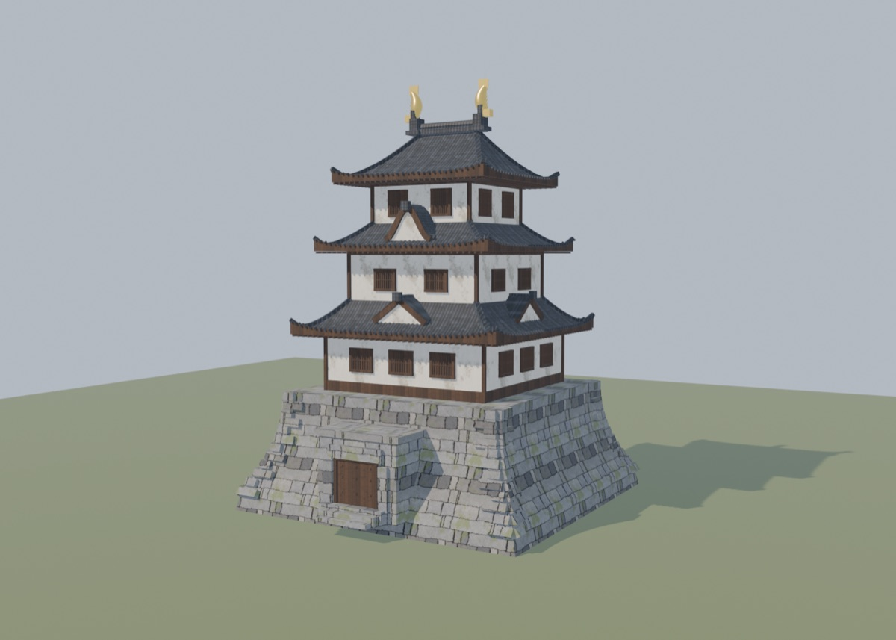
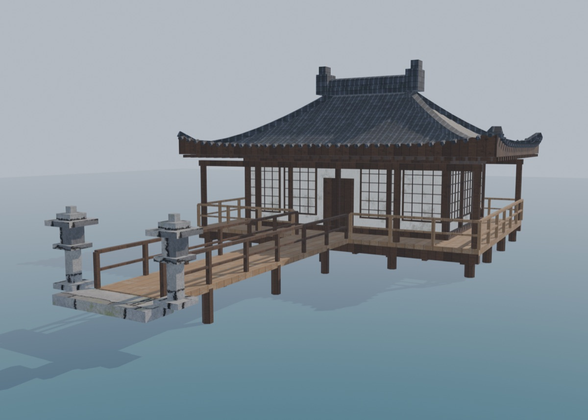
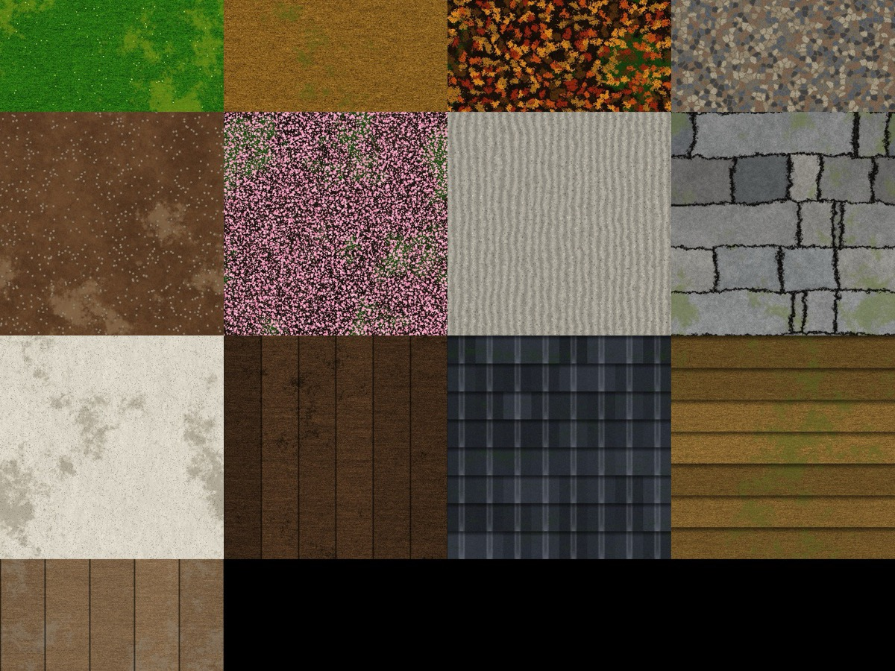
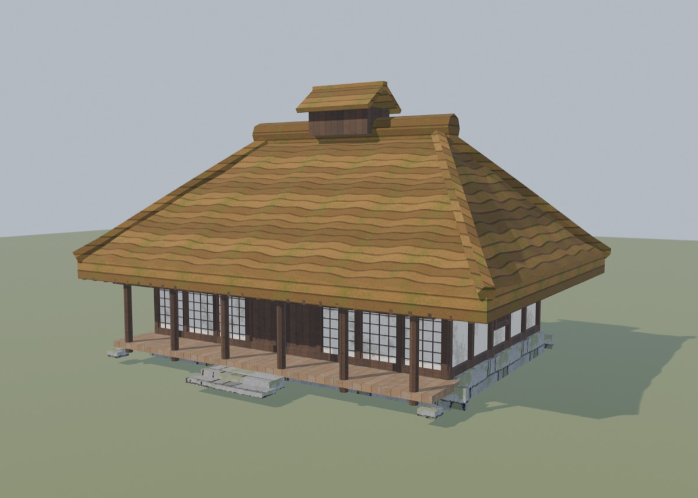
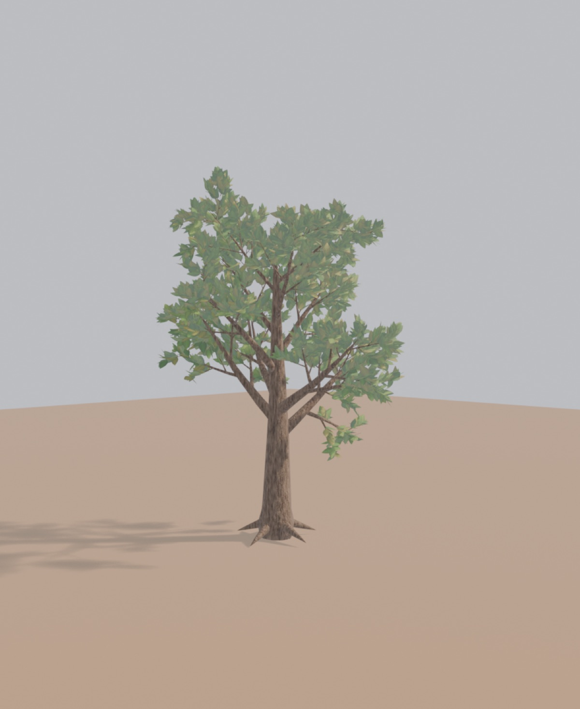
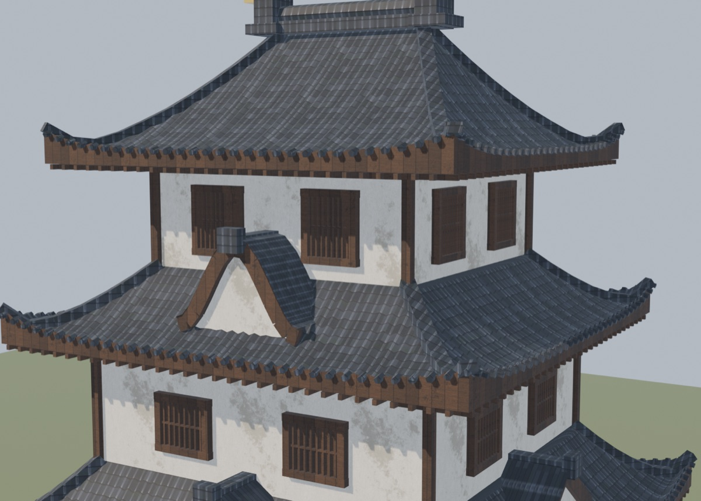

# agent-skill-blender-export-three.js

**A verified pipeline from Blender to three.js: bake, LOD, compress, validate, export, and check the result in a real engine. Packaged as a skill for Claude Code, Codex and other coding agents.**


<p align="center">
  
  
</p>
<p align="center"><sub>Procedurally modelled, textured with generated tileable PBR, LOD'd and exported by this pipeline. QA renders straight from the build.</sub></p>

---

## What this is

Getting an asset from Blender into a browser game is a loop with a dozen quiet ways to go wrong: a bake that silently produces a flat texture, normal maps that are upside down, alpha that exports as the wrong mode, textures that ship twice, LODs nobody checked. **This repo turns that loop into something an agent (or a human) can run and trust.**

```
spec.json ─▶ recipe / generator ─▶ validator gate ─▶ GLB export ─▶ inspect the exported FILE ─▶ manifest ─▶ preview ─▶ three.js engine check
(budgets,     (decimate, cards,      (zero errors or     (meshopt +       (stdlib Python,         (per-LOD      (re-imported        (loads the compressed
 recipe)       bake, impostor,        nothing ships)      KTX2)            no Blender needed)       tris/size)    uncompressed twin)   files, reports back)
               procedural assets)
```

The core idea is a deterministic **gate**. Agents bring judgement (writing recipes, fixing failures, art direction); scripts decide "done". An asset only ships when the validator reports zero errors, the exported GLB itself passes inspection, and it loads in three.js.

## Highlights

- **Verified export.** Per-asset triangle, material, texture and file-size budgets; UV, scale, origin, mesh-hygiene, alpha-mode and *blank-bake* checks; per-LOD budgets inside one multi-LOD GLB.
- **Compression with no extra tools.** Meshopt geometry + KTX2/BasisU textures through Blender's built-in glTF exporter, plus a small step that strips the duplicate PNG/JPEG fallbacks Blender embeds (21 MB → 5 MB on the hero tree).
- **Recipes** that turn heavy hero assets into game-ready LODs: tree (leaf cards on a generated atlas, baked bark, impostor LOD), prop/rock, grass blade packs, and multi-material buildings.
- **Procedural generators** for architecture (castle keep, thatched farmhouse, waterside teahouse) built from shared geometry code, using world-space UVs so texel density is constant.
- **Tileable PBR texture generator** (13 sets: biomes, stone, plaster, timber, roof tile, thatch) with an automatic **seam / range / flatness checker that has a negative test**, because a checker that cannot fail proves nothing.
- **A reusable three.js runtime** (plain ES modules, no build step): biome-blended terrain, GPU wind grass, instanced tree LODs, planar-reflection water, procedural sky, MSAA + bloom + grade, player controller, adaptive resolution.
- **Agent-ready.** `SKILL.md`, `AGENTS.md`, a Blender-trap **linter**, a `GOTCHAS.md` of 40 hard-won Blender 5.3 / three.js traps, a headless entry point and a live-session entry point.

<p align="center">
  
  
</p>

## Requirements

| | |
|---|---|
| **Blender** | 5.x (developed and tested on 5.3.0, macOS / Apple Silicon). Auto-detected at `/Applications/Blender.app`; otherwise `export BLENDER=/path/to/Blender`. |
| **Python 3** | system Python for the linter and the GLB inspector (stdlib only). Blender's bundled Python runs everything else (numpy is included). |
| **A WebGL2 browser** | for the engine check and the viewer. |
| **Node** *(optional)* | only for the JS syntax test. |

Nothing is downloaded or installed at build time: compression is Blender's own exporter.

## Quick start

```bash
git clone https://github.com/RNT56/agent-skill-blender-export-three.js && cd agent-skill-blender-export-three.js

bin/gp test                                  # lint + validator + recipes + textures + goldens + JS (a few minutes, needs Blender)
bin/gp textures specs/biomes.json            # 13 tileable PBR sets + seam checks      -> out/textures/
bin/gp textures specs/rocks.json             # 6 cliff / mountain rock sets (orm.b = height map)  -> out/textures/
bin/gp generate generators/samurai_keep.py   # procedural keep                         -> fixtures/samurai_keep.blend
bin/gp build specs/samurai_keep_01.json      # recipe -> gate -> GLB -> inspect -> manifest -> preview   -> out/samurai_keep_01/
bin/gp build specs/tree_maple_01.json        # tree: LOD0-2 + impostor LOD3
bin/gp build specs/grass_blades.json         # wind-ready blade pack for GPU instancing
bin/gp view                                  # http://localhost:8765/viewer/?asset=samurai_keep_01  (engine check)
bin/gp lint my_script.py                     # catch Blender traps before running bpy code
bin/gp glb out/<asset>/*.glb                 # inspect exported files, no Blender needed
```

Build the textures first: the generators and the building recipes use them. `bin/gp help` lists every command.

## Use it as an agent skill

**Claude Code**

```bash
mkdir -p ~/.claude/skills
ln -s "$(pwd)/skills/blender-gamepipe" ~/.claude/skills/blender-gamepipe     # or copy it into <project>/.claude/skills/
```

**Codex and other agents:** `AGENTS.md` at the repo root is the short guide and points to `skills/blender-gamepipe/SKILL.md`.

The skill's one rule: **never claim an asset is done from your own reading of a log or a render.** Done means (1) `bin/gp build` exited 0 and the manifest says `passed: true`, (2) you actually looked at the preview image, and (3) the files load in three.js. See [`skills/blender-gamepipe/SKILL.md`](skills/blender-gamepipe/SKILL.md).

## What's in the box

| Recipe / tool | Input | Output |
|---|---|---|
| `tree` recipe | bark mesh + leaf mesh (one island per leaf) | LOD0-2 (baked bark, alpha-cut leaf cards, bent normals) + LOD3 crossed-card impostor; palettes `green`, `autumn`, `sakura`, `gold` |
| `prop` recipe | one mesh with a procedural material | decimated LODs sharing one baked PBR set |
| `grass` recipe | none (generated) | blade pack: 3 variants × 2 LODs, 30 triangles, `uv.y` = height along the blade |
| `building` recipe | authored multi-material LODs (`<x>_LOD<n>_<Material>`) | **one** GLB with all LODs; textures shared; per-LOD budgets |
| `gp_texgen` | spec | tileable albedo / normal / ORM sets + contact sheet + seam report |
| generators | none | `samurai_keep` (23 m castle keep), `minka` (thatched farmhouse), `teahouse` (on stilts, with pier) |
| `runtime/*.js` | the exported assets | terrain biomes, grass, forests, water, sky, post, player |
| `tools/export_world.py` | `out/` | a self-contained game folder (refuses assets that failed the gate) |

Triangle budgets as built: keep 57k / 16k / 4.5k, farmhouse 12k / 3.4k / 0.9k, teahouse 20k / 6.5k / 0.8k, tree 38.5k / 13.7k / 2.8k / 4 (impostor).

<p align="center">
  
  
</p>

## A spec

```jsonc
{
  "name": "tree_maple_01", "type": "tree", "recipe": "tree",
  "source_blend": "fixtures/tree_source.blend", "root_object": "Tree",
  "budgets": { "max_materials": 2, "max_texture_px": 2048, "max_file_mb": 10 },
  "recipe_cfg": {
    "bark_obj": "Tree_Bark", "leaf_obj": "Tree_Leaves", "tex_px": 2048, "leaf_palette": "autumn",
    "lods": [ { "name": "LOD0", "bark_tris": 22000, "leaf_keep": 1.0, "max_tris": 40000 },
              { "name": "LOD1", "bark_tris": 7000,  "leaf_keep": 0.4, "leaf_scale": 1.45, "max_tris": 14000 } ],
    "impostor": { "name": "LOD3", "px": 1024, "max_tris": 20 }
  },
  "glb_expect": { "alphaMode": { "leaf": "MASK" }, "occlusion": ["bark"] },
  "export": { "compress": true }
}
```

A recipe is a module with `META` and `build(spec, out_dir) -> [derived specs]`; the contract is enforced (`gamepipe/gp_recipe.py`). Add one by dropping a module in `gamepipe/recipes/`, a spec in `specs/`, and a test in `tests/`.

## Validator codes

| Code | Meaning |
|---|---|
| `BUDGET_TRIS` / `BUDGET_LOD_TRIS` / `BUDGET_FILE_SIZE` / `BUDGET_MATERIALS` | over budget (per asset, per LOD, per file) |
| `MAT_PROCEDURAL` | shader nodes glTF cannot carry: bake them (recipes do) |
| `TEX_BLANK` | a texture is flat: **a bake silently failed** |
| `ALPHA_BLENDED` / `GLB_ALPHA_BLEND` | alpha will export as `BLEND`; route it through Math → Round for `MASK` |
| `UV_MISSING`, `XFORM_NEG_SCALE`, `ORIGIN_NOT_AT_BASE`, `MESH_ZERO_AREA`, `MOD_GEONODES` … | geometry and transform hygiene |
| `GLB_*` | problems found in the **exported file** itself |
| `NOT_TILEABLE`, `TEX_FLAT`, `ALBEDO_RANGE` | texture-generator checks |

Fix them; do not silence them.

## The runtime

Plain ES modules in `runtime/`, no bundler. Import `runtime/index.js` and wire what you need:

```js
import { createLoader, loadBiomeArrays, applyLook, createSky, createTerrain, GrassField, createGrassUniforms,
         InstancedForest, Water, createPost, Player, AdaptiveResolution } from './runtime/index.js';
```

| Module | What it does |
|---|---|
| `assets.js` | GLB loader with meshopt + KTX2; biome PBR texture arrays |
| `terrain.js`, `rocks.js` | heightfield, 7-biome splat blending, anti-tiling, tangent-space normals; six cliff / mountain rock materials chosen by slope, altitude and noise (two strongest blended by their height maps, biplanar projection, whiteout normals); the tall-grass field as a colour map so far ground wears the field's colours; contact shading around buildings; shoreline wetness, walkability overlay, seasonal tint + snow. Procedural boulders and outcrops (instanced, 2 LODs) that share the terrain's rock materials in world space |
| `grass.js`, `grass_clump.js`, `grass_trample.js`, `grass_lod.js` | chunked tiers; GLB blades or procedural tall-field clumps with seed heads (rolling wind bands, gust cells, season ripeness); translucency; a persistent trample field (any number of walkers part the grass sideways, press it along their heading, and it springs back over seconds); streaming that never pops (new chunks grow in, replaced ones fade under them, built ahead of the camera within a time budget); density and blade width follow ONE smooth law of distance (no ring where the field gets sparser, no edge where it ends) |
| `trees.js`, `foliage.js` | instanced LOD buckets, sway, leaf translucency |
| `water.js`, `water_waves.js` | wind-driven lake: one wave model shared by GPU and CPU physics, baked-bed shoreline with foam and swash, per-channel absorption, caustics, planar reflection, sun / moon glints, live ripples; `heightAt` / `normalAt` / `depthAt` for floating things |
| `aquatic.js`, `fauna.js` | reeds with cattails, lily pads and lotus, drifting petals, shore rocks; koi, ducks, dragonflies (instanced, season- and fog-aware) |
| `env_clock.js`, `env_atmosphere.js`, `env_seasons.js`, `env_weather.js` | world clock with real solar / lunar astronomy, keyframes indexed by sun elevation (`looks/atmosphere.json`), seasons (grass, leaves, ground, snow, particles), weather state |
| `env_sky.js`, `env_lighting.js`, `env_grade.js`, `noisetex.js` | dynamic sky (stars, moon, clouds), sun / moon key light rig with lamps, full colour grade, one tileable noise texture for cheap shader noise |
| `sky.js`, `look.js` | procedural sky with lit clouds; shared lighting look (`looks/*.json`, also drives the Blender preview) |
| `post.js` | MSAA HDR target (+ optional depth texture) → bloom → ACES tonemap → `env_grade` colour grade |
| `player.js`, `scatter.js`, `quality.js`, `noise.js` | first-person controller, Poisson-ish scatter, adaptive resolution, seeded noise |

## Testing

`bin/gp test` runs ten suites, 120 checks: linter, validator, recipes (prop, grass, contract), texture generator (including the negative test), the full texture set, and golden regressions that rebuild the keep, the farmhouse, the teahouse and the hero tree and compare triangle counts, scale, materials, texture formats and compression against golden ranges, plus a JS syntax check. A refactor of the shared generator code was verified by identical triangle counts.

`docs/ci.example.yml` is an **untested** GitHub Actions example; verify the Blender download URL before enabling it.

## Gotchas

[`GOTCHAS.md`](GOTCHAS.md) records 40 traps that each cost real time, with the guard that now catches them: `is` vs `==` on bpy nodes, bakes that need an active-and-selected image node, Blender images being bottom-up, JPEG corrupting data channels, KTX2 shipping twice, alpha mode coming from a Round node, hidden browser panes reporting a 0×0 window, GPU timing on Metal, and more.

## Layout

```
gamepipe/        core: texgen, validate, export, glb, lint, cli, live, preview, recipe contract, recipes/
generators/      procedural architecture (samurai_keep, minka, teahouse) + shared gen_common
runtime/         three.js engine modules
specs/           asset specs            looks/     shared lighting look
tools/           export_world.py        viewer/    single-asset engine check
fixtures/        golden input .blend files        tests/     test suites
skills/          the agent skill        docs/      images, CI example
bin/gp           one entry point        out/       build output (git-ignored)
```

## Limitations (honest)

- **Procedural, not sculpted.** The architecture is generated from code; it is not hand-modelled or scanned fidelity.
- **Not covered:** skeletal animation and characters, rivers/waves/underwater, terrain streaming, audio, physics.
- **Lower tree LODs reuse LOD0's normal map**; bark roughness is derived from albedo luminance, not baked from a roughness pass.
- **Performance** was measured on one machine (Apple M4, Metal, an embedded browser). The adaptive-resolution scaler is untested on slow GPUs.
- **Validated on Blender 5.3 only.** Several fixes are specific to its glTF exporter (alpha mode from the node graph, KTX2 handling).
- **Linter is heuristic**: it flags likely mistakes, not proofs.

## License

[MIT](LICENSE): use it, change it, ship it. Issues and pull requests are welcome.

