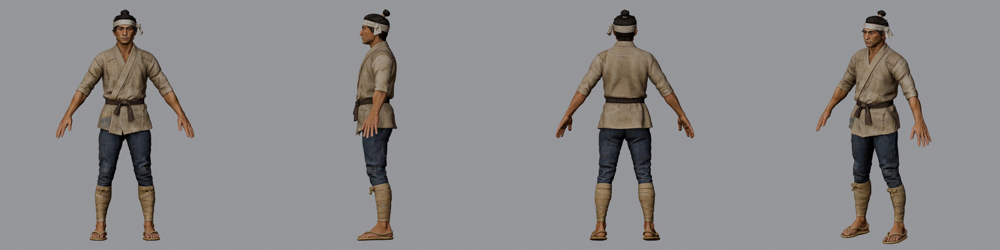
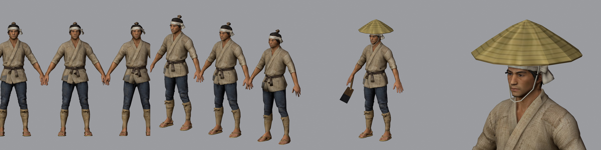
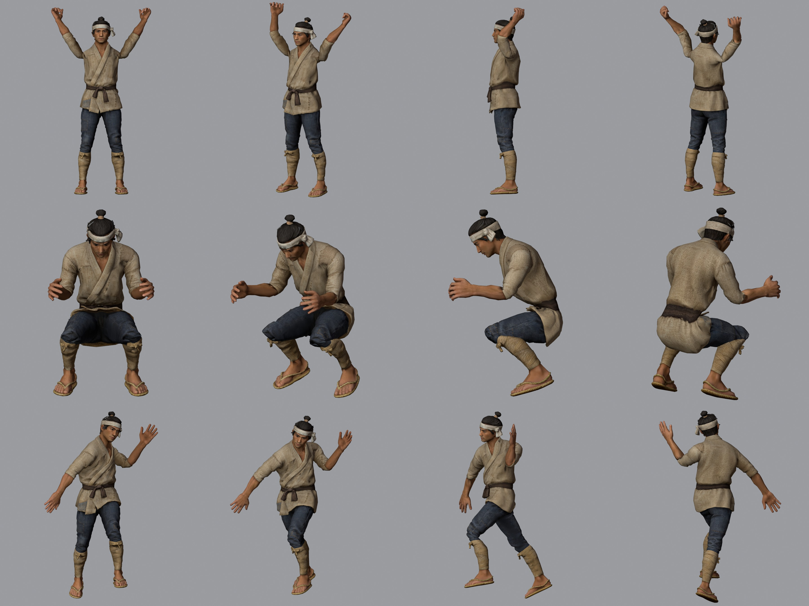
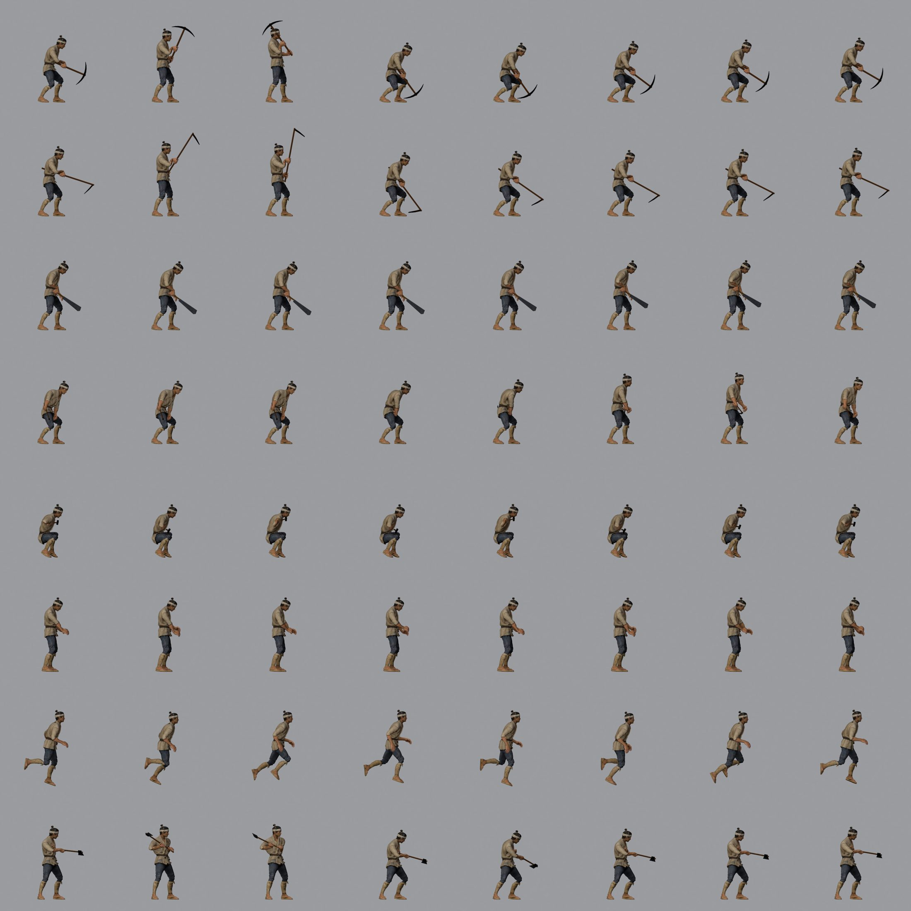
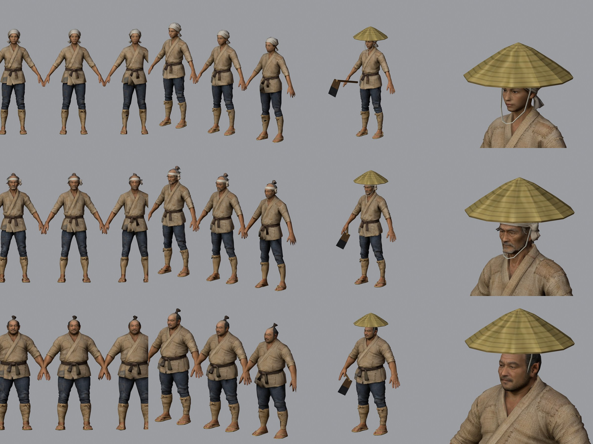
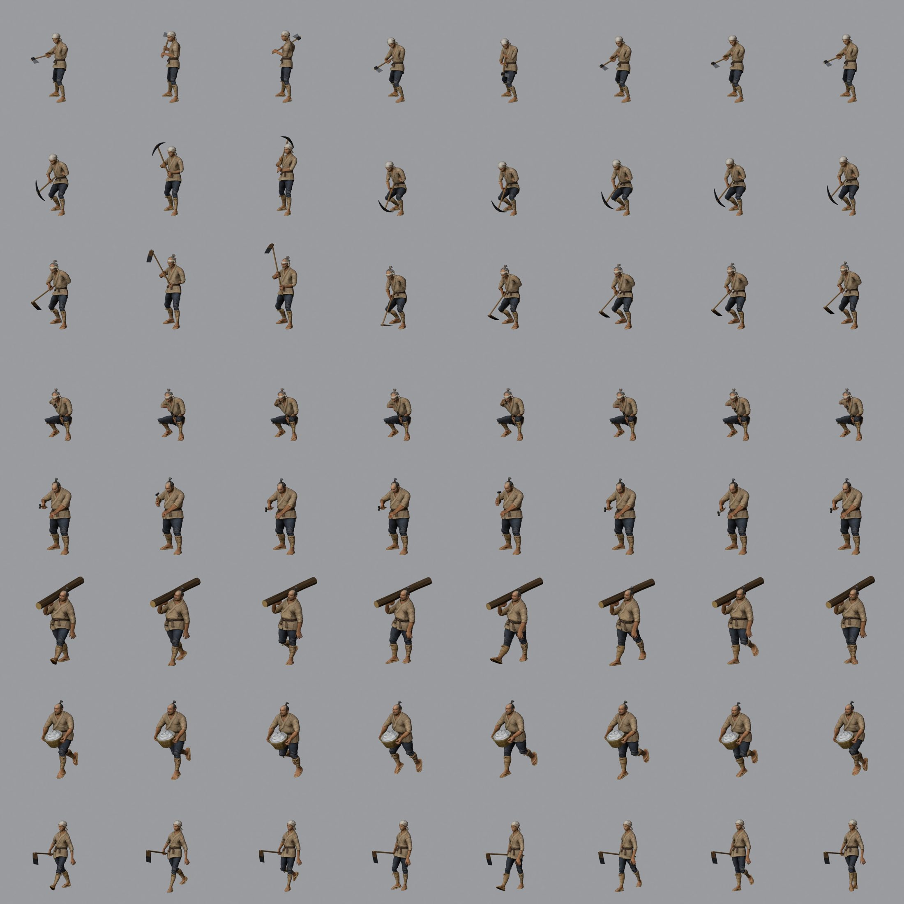

# The villager unit: an image-to-3D mesh made game-ready (`generators/villager/`)

The samurai and the archer are procedural. The villager is the other route: **reference image -> image-to-3D -> auto-rig -> clean-up and animation here -> the same gate**.
The outside steps were run through Higgsfield (image: GPT Image 2.6; mesh: Tripo H3.1; rig + motion capture: Meshy); their results are kept in `fixtures/villager_src/`.
Everything below runs headless (`blender -b`), one stage per call, each reading what the one before left in `$VILLAGER_WORK` (a scratch directory: delete it afterwards).

| stage | module | what it does |
|---|---|---|
| `ingest` | `ingest.py` | import, bake transforms, stand on z = 0, face -Y, scale to 1.68 m, weld, drop floaters, report shells / texture sizes / cross-sections |
| `lowpoly` | `lowpoly.py` | LOD0 by collapse decimation with a protection vertex group (hands, face), and a throwaway UV + albedo bake: the GLB uploaded for auto-rigging |
| `rig` | `rig.py` | a clean armature at the auto-rig's joints (metres, blend-up names), weights carried over by position and smoothed, hands MEASURED on the mesh (thumb, finger crotches, palm frame), finger / grip / line / load bones |
| `atlas` | `atlas.py` | UV charts by body part and half (from the skin weights), small pieces merged, angle-based unwrap, per-part texel density, packed into the body's band; then the real bake high -> low (albedo as emission, normal incl. the source's normal map, roughness, AO, a position map) |
| `clips` | `clips.py` | motion capture retargeted as armature-aligned deltas, looped, re-pitched (`amplify`), variants by re-solving the arms; the trades authored with a swing model in the chest's frame. QA strips per clip |
| `finalize` | `finalize.py` | prop strip painted (`props.paint_strip`), jacket mask from position + colour, 1024 game textures, LOD1 / LOD2, collection `villager_game`, fixture |

Then `bin/gp build specs/villager_unit_01.json` and `blender -b fixtures/villager_unit.blend -P tests/test_villager_golden.py` (34 checks). Game side: samurai-vale `docs/VILLAGER_UNIT.md` (it has the exact commands).

## More than one body (`generators/villager/variants.py`)

Every stage takes `--name villager_unit_0N`; the table in `variants.py` holds what differs (height, sources, the hat's seat) and writes the body's spec. What made the pipeline body-independent:
- **References made as a family**: the first reference image is given as a style / pose / clothing reference for the others and only the PERSON is described anew, so every mesh arrives in the same A-pose with the same garment layout (jacket, belt, trousers, gaiters): the measuring code (hands, jacket mask, load seats) then needs no per-body tuning. All three new bodies passed every stage on the first run.
- **Own auto-rig and own motion capture per body** (three clips, 8 credits each): the joints differ, so captured motion is taken on the body it will play on rather than retargeted across proportions.
- **Authored clips are re-fitted, not re-authored**: they are written in the reference body's rest coordinates; `clips.Body.chest_ref` maps those onto another body by putting the reference's shoulder line on its own and scaling by its arm reach (0.94 to 1.02 here), squat depths scale by leg length. The fit's scale is stripped from hand frames (`place_hand`).
- **The undyed jacket is normalised to one brightness** (linear 0.339) in `finalize`, so one dye constant in the engine serves every body.
- **Regression**: after generalising, body 1 was rebuilt from its sources: same clip statistics, the gate and the golden test pass; the GLB differs by 0.04% in size (bake and JPEG are not bit-stable).
- Not automatic: the hat's seat (`hat_drop`): a shaved pate needed 33 mm more than hair. Look at `qa/final_sheet.jpg` of a new body.

## Hiding: `crouch_idle` and `sneak` (added 2026-11-19)
Two authored loops for a villager taking cover in tall grass (`clips.HIDE`); the game's crouch silhouette is 0.95 m.
- `crouch_idle` (5.0 s, 150 frames): down on his haunches, heels up, torso over the knees, the left forearm across the left knee, the right hand low by the right foot
  (a tool in it lies level, pointing ahead); two breaths a loop, a glance to the left and to the right. Head top 0.84 to 0.94 m over the four bodies.
- `sneak` (0.9 s, 27 frames, `speed_mps` 1.20): a deep creep in place. Feet are placed by the BALL (`plant_ball`: the ankle is derived from the ball and the heel's
  pitch, so a peeling heel does not drag the toe), each ball travels back at exactly 1.2 m/s for 62% of the cycle and is carried forward on a Hermite path that
  leaves and lands at ground speed. Rotated to start on the left foot's reach like walk / run. Head top 0.98 to 1.09 m.
- Hands and feet are placed relative to the body's own joints, so these two need no fitting to the other bodies (`Body.chest_ref` is not used).
- They were added to the finished bodies with `--stage add_clips` (it opens `fixtures/<name>.blend`, writes only these Actions, saves, then renders
  `out/villager_qa_hide/`): the 20 delivered clips, meshes and textures stay byte-identical in the GLB. The hand frames `curl()` needs are read back from the
  grip bones (`clips.hands_from_rig`), so no work directory is needed. A full rebuild makes them in `--stage clips` like every other clip.
- `tests/test_villager_golden.py` measures the skinned meshes at every frame (head top, every tool, lowest point), the planted toe's speed, the footfall,
  and holds the 20 delivered clips to `tests/villager_clips_baseline.json`.

## Things learned (candidates for GOTCHAS.md)
1. **Smart UV Project on a decimated organic mesh** gives thousands of islands (17% of the atlas used). Cut charts along the body instead: label faces by skin weight + a half-space, merge small pieces, mark seams between labels, unwrap. 21 islands.
2. **Minimum-stretch unwrap** left several half-shells as the disc it starts from and gave up on four; angle-based solved all of them. Keep a conformal / planar fallback and COUNT zero-area UV faces afterwards.
3. **Packing into a non-square band**: pack once with rotation, squash u by the band's aspect, pack again WITHOUT rotation, then map the unit square onto the band. Squashing before a rotating pack distorts every turned island.
4. **Decimate's vertex group**: weight 1 = decimate freely, low = keep; the response is steep (0.88 on the hands doubled their triangles). Check the count per region, not the look.
5. **An auto-rig's armature is not a rig to keep** (0.01 scale, heuristic tails, no hands), but its JOINTS and WEIGHTS are good: rebuild the armature at the same joints, carry the weights over by nearest vertex (the mesh must be the uploaded one: assert the distance), smooth twice.
6. **Motion capture moves between rigs as armature-aligned deltas** (`R q R^-1` of the basis rotation): independent of bone rolls and tails, exact when the joints coincide. `samurai/pose.py` then edits it like any authored pose.
7. **A capture's pace can be re-pitched**: scale each bone's rotation about its mean over the cycle (legs 0.69x turned a 4.2 m/s run into a 2.8 m/s trot), re-seat the feet on the ground, MEASURE the stride speed on the result (planted toe).
8. **Rotate every gait cycle to the same footfall** before deriving variants, or an engine that carries the stride phase across gaits swaps feet in the fade.
9. **Hands on a mesh nobody modelled for rigging**: slice along the hand's axis and watch the connected components: the first separate short piece is the thumb, the first slice with three or more long pieces is the finger crotches; the knuckles are 2 cm behind.
10. **Swing tools in the chest's frame**, hands on a small arc about a point in front of the sternum: every pose is inside both arms' reach by construction, and the torso's keys supply the amplitude. Log the reach ratio and the working end's lowest point.
11. **Single-level KTX2 on cloth sparkles**: weave is all high frequency. Ship plain images at the size the camera needs and let the engine mip-map.
12. **`quat.slerp` refuses factors above 1**: scale the angle of `to_axis_angle()` instead.
13. **8-bit Blender images hold display values** in `pixels`: paint sRGB numbers into an sRGB image, do not linearise first.

## Limits
Four bodies, adults only. Light the image model baked into the albedo was not removed. The collapse-decimated LOD0 is triangles, not an animator's quad topology; it deforms well in the tested poses (overhead, squat, twist), not everywhere. The work clips are code, not capture.
